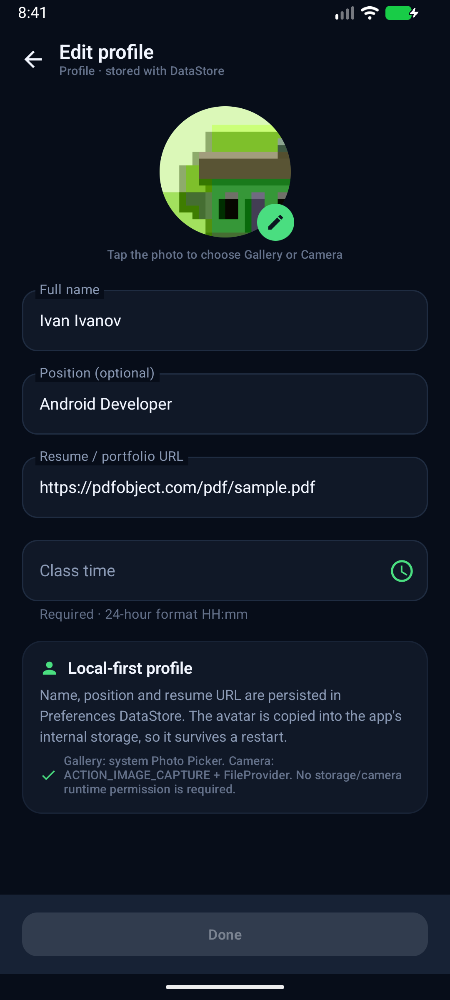
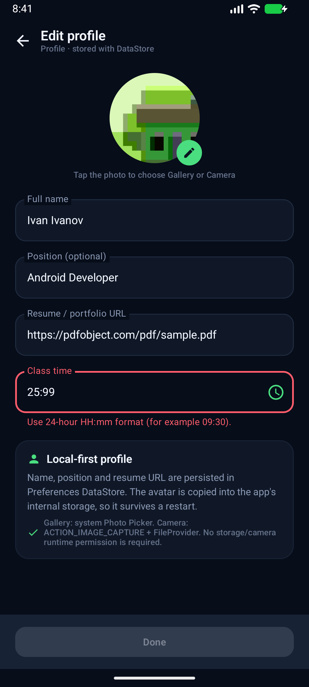
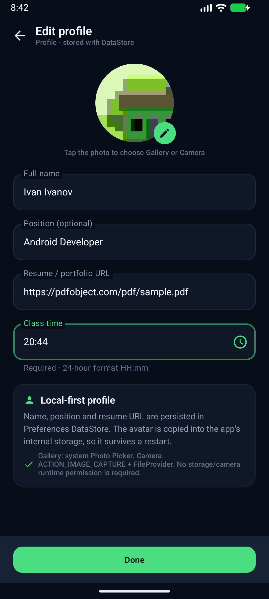
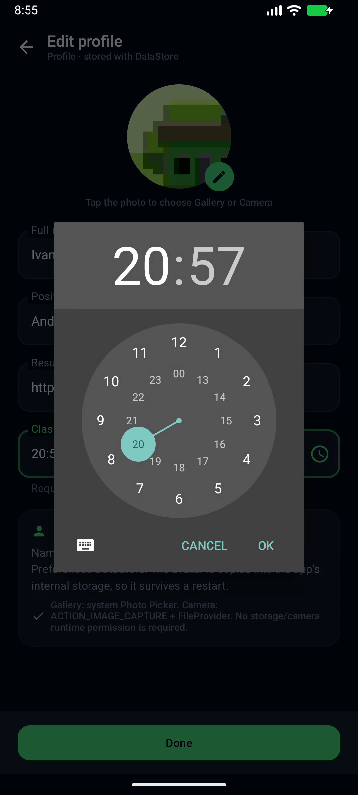
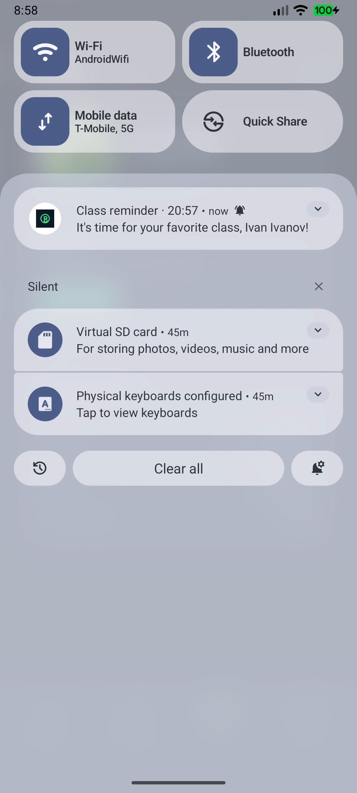

# CoinPulse — практика 7

Практика **«Время любимой пары» (уведомления)**. В профиль добавлено поле времени пары,
его можно ввести вручную или выбрать через виджет часов. В установленное время приходит
локальное push-уведомление с именем пользователя, по нажатию открывается приложение.

## Скриншоты

| Поле времени в профиле | Ошибка валидации HH:mm |
| --- | --- |
|  |  |
| **Ввод с клавиатуры** | **Выбор времени с часов** |
|  |  |
| **Профиль с напоминанием** | **Push-уведомление** |
|  |  |

## Демо

- Практика 3: https://github.com/user-attachments/assets/97b5b6cb-fb10-4d4e-b71c-c4c491aa2930
- Практика 4: `docs/demo_practice4.mp4`
- Практика 5: `docs/demo_practice5.mp4`
- Практика 6: `docs/demo_practice6.mp4`
- Практика 7: **`docs/demo_practice7.mp4`**

В записи:
1. ручной ввод времени;
2. неверное время `25:99` → ошибка, Done недоступен;
3. корректное время → Done доступен;
4. выбор времени через часы (TimePicker);
5. профиль с напоминанием;
6. срабатывание уведомления в установленное время;
7. нажатие на уведомление открывает приложение.

Видеофайлы не коммитятся в git и прикладываются к сдаче отдельно.

## Реализация

### Время пары

- В `UserProfile` добавлено поле `classTime`.
- Оно сохраняется в Preferences DataStore (`user_profile` → `class_time`).
- Поле редактируется двумя способами:
  - вручную с клавиатуры;
  - через `TimePickerDialog` (кнопка с иконкой часов).
- Формат — **24-hour `HH:mm`**, валидация регуляркой:
  `^([01]\d|2[0-3]):[0-5]\d$`.
- Если поле пустое или неверное, кнопка **Done** недоступна, а под полем показывается ошибка.
- Время отображается в профиле в строке **Class reminder**.

### Планирование и уведомление

- `AlarmReminderScheduler` реализует `ReminderScheduler` через `AlarmManager`.
- Время срабатывания — ближайшее наступление `classTime`:
  сегодня, если время ещё не прошло, иначе завтра.
- Используется `setExactAndAllowWhileIdle`, если доступны точные будильники; иначе
  `setWindow` с коротким окном, чтобы не требовать специального доступа к exact alarms.
- `ClassReminderReceiver` — `BroadcastReceiver`:
  - создаёт `NotificationChannel` `class_reminder`;
  - показывает уведомление через `NotificationManagerCompat`;
  - текст: «It's time for your favorite class, {name}!»;
  - `PendingIntent` открывает `MainActivity` по нажатию.
- На Android 13+ перед сохранением запрашивается `POST_NOTIFICATIONS`.
- Напоминание работает и после выгрузки приложения из памяти: его держит AlarmManager,
  а receiver запускается системой.

### Разрешения и разные версии Android

- `POST_NOTIFICATIONS` запрашивается на Android 13+ (API 33+); на более старых версиях
  уведомления разрешены по умолчанию.
- Для файлов/камеры из практики 6 runtime-разрешения не нужны: используются system Photo
  Picker и `ACTION_IMAGE_CAPTURE` через FileProvider.
- Проверено на эмуляторе **Android 17 (API 37)**: уведомление пришло в заданное время,
  нажатие открыло приложение.
- Других системных образов в окружении не было, поэтому отдельно на API 24–36 приложение
  не запускалось. `minSdk = 24`; используемые API имеют fallback для старых версий.

## Архитектура

```
domain/
  model/UserProfile.kt          # + classTime
  repository/ReminderScheduler.kt
  usecase/ProfileUseCases.kt    # ScheduleClassReminderUseCase
  validation/ProfileValidator.kt
data/
  notifications/AlarmReminderScheduler.kt
  notifications/ClassReminderReceiver.kt
  local/ProfileRepositoryImpl.kt
presentation/
  profile/EditProfileScreen.kt  # TimePicker + permission request
  profile/EditProfileViewModel.kt
  profile/ProfileScreen.kt
di/AppContainer.kt
```

- ViewModel вызывает use case сохранения профиля и планирования напоминания.
- `AlarmManager`, `BroadcastReceiver` и `NotificationManager` находятся в data-слое.
- `domain` не зависит от Android.

## Тесты

```bash
./gradlew testDebugUnitTest
```

**26 unit-тестов**, все проходят. Добавлены проверки `HH:mm`‑валидации и поля `classTime`
в `UserProfile`.

## Сборка

```bash
./gradlew assembleDebug
```

## Ветка и PR

Ветка: `feature/practice-7-notifications`.

```bash
git push -u origin feature/practice-7-notifications
```

PR создаётся из `feature/practice-7-notifications` в `main`.
