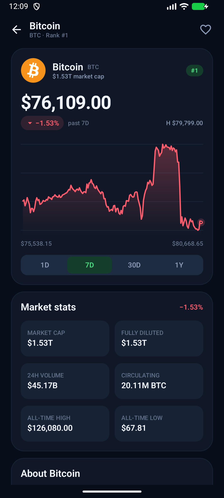
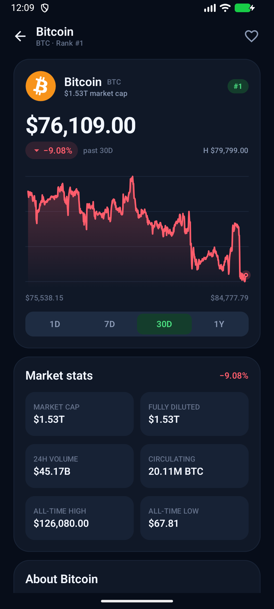
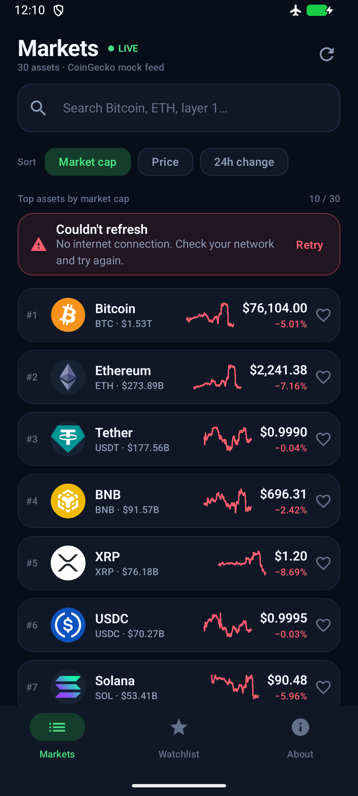
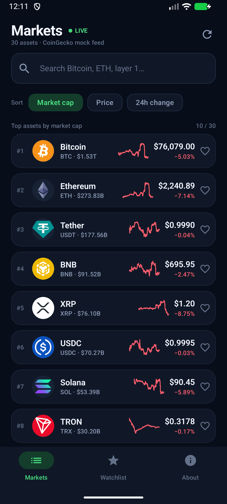
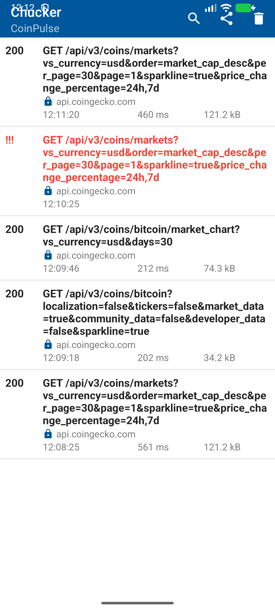

# CoinPulse — практика 4

Android-приложение по открытым данным **CoinGecko**. Список криптовалют, поиск, сортировка,
пагинация, экран деталей, график цены, watchlist и нижняя навигация.

В этой практике данные загружаются **из реального API** через Retrofit/OkHttp. Проект
разделён на слои **domain / data / presentation**, сетевые запросы управляются
ViewModel через use cases, есть состояния загрузки, ошибок и retry.

## Скриншоты

| Живой список монет | Экран деталей |
| --- | --- |
|  |  |
| **Живой график 30D** | **Ошибка сети + retry** |
|  |  |
| **Восстановление после retry** | **Chucker: выполненные запросы** |
|  |  |

Скриншоты практики 3 остались в `docs/screenshots/` для истории.

## Демо

- Практика 3: https://github.com/user-attachments/assets/97b5b6cb-fb10-4d4e-b71c-c4c491aa2930
- Практика 4: локальная запись `docs/demo_practice4.mp4` (не коммитится в git —
  приложите её к сдаче отдельно). В записи: загрузка, список, детали, отключение сети,
  ошибка, восстановление по Retry.

## Что реализовано

- **Сеть** — Retrofit 2 + OkHttp + Gson, все запросы асинхронные, выполняются на
  `Dispatchers.IO` внутри репозитория.
- **Clean Architecture**:
  - `domain` — модели, интерфейс репозитория, use cases, доменные ошибки;
  - `data` — CoinGeckoApi, DTO, mappers, NetworkModule, реализации репозитория и
    локального хранилища;
  - `presentation` — Compose-экраны, ViewModels и UI-состояния.
- **MVVM** — ViewModel + `StateFlow` + `collectAsStateWithLifecycle`; UI не знает про
  Retrofit и DTO.
- **Загрузка** — skeleton-состояния для списка и деталей, pull-to-refresh,
  индикатор пагинации, отдельный индикатор загрузки графика.
- **Ошибки** — доменные `AppException`: нет интернета, rate limit (429), ошибка сервера,
  пустой ответ. Для списка показывается баннер с Retry, для деталей — полноэкранное
  состояние ошибки, для графика — отдельная ошибка с повтором.
- **Конфигурируемые запросы**:
  - query-параметры `vs_currency`, `order`, `per_page`, `page`, `sparkline`,
    `price_change_percentage`;
  - path-параметр `{id}` для деталей и `{id}` + query `days` для графика.
- **Кэширование** — in-memory кэш снимка рынка, деталей и графиков + HTTP-кэш OkHttp;
  избранное хранится в `StateFlow`.
- **Chucker** — debug-интерсептор и экран Network inspector в разделе About.
- **Пагинация** — по 10 монет. Из-за жёсткого лимита keyless CoinGecko приложение
  загружает снимок топ-30 одним запросом и делает поиск/сортировку/пагинацию по нему;
  это осознанная стратегия кэширования, а не мок-данные.
- **Тесты** — 13 unit-тестов на mappers, кэш, пагинацию, поиск, сортировку, ошибки,
  избранное и графики.

## Чистая архитектура

```
app/src/main/java/ru/urfu/coinpulse/
├── di/
│   └── AppContainer.kt              # ручной DI-граф
├── domain/
│   ├── model/                       # Coin, CoinDetails, CoinPage, CoinSort, ChartRange
│   ├── repository/CoinRepository.kt # контракт, не знает про Android/Retrofit
│   ├── error/AppException.kt        # доменные ошибки
│   └── usecase/CoinUseCases.kt      # GetCoins, GetCoinDetails, GetChart, ...
├── data/
│   ├── remote/
│   │   ├── CoinGeckoApi.kt          # Retrofit API
│   │   ├── dto/                     # JSON-модели
│   │   └── mapper/                  # DTO -> domain
│   ├── network/NetworkModule.kt     # OkHttp, cache, Chucker, Retrofit
│   ├── local/FavoritesStore.kt      # StateFlow с избранным
│   └── repository/CoinRepositoryImpl.kt
└── presentation/
    ├── market/                      # экран + ViewModel + UiState
    ├── details/                     # экран + ViewModel + UiState
    ├── watchlist/
    ├── about/
    ├── components/
    ├── navigation/
    └── theme/
```

Направление зависимостей:

```
presentation ──> domain <── data
```

`domain` не зависит от Android SDK, Retrofit и Gson. `data` реализует контракт
`CoinRepository`. `presentation` работает только с use cases.

## Сетевой поток

```
Compose screen
    │ intent (refresh/search/sort/range)
    ▼
ViewModel ──> UseCase ──> CoinRepository
    ▲                        │
    │ StateFlow<UiState>     ├── in-memory cache (StateFlow)
    └────────────────────────┤
                             ├── OkHttp HTTP cache
                             └── CoinGeckoApi (Retrofit, Dispatchers.IO)
                                      │
                                      ▼
                                 CoinGecko API
```

- ViewModel запускает корутину в `viewModelScope`; репозиторий переключается на
  `Dispatchers.IO` через `withContext`.
- Результат возвращается как `Result<T>`; ошибки мапятся в `AppException` в data-слое.
- UI получает иммутабельный `UiState` и рисует loading / content / error.

## Endpoints

| Назначение | Запрос |
| --- | --- |
| Список | `GET /coins/markets?vs_currency=usd&order=market_cap_desc&per_page=30&page=1&sparkline=true&price_change_percentage=24h,7d` |
| Детали | `GET /coins/{id}?localization=false&tickers=false&market_data=true&community_data=false&developer_data=false&sparkline=true` |
| График | `GET /coins/{id}/market_chart?vs_currency=usd&days=1\|7\|30\|365` |

Base URL: `https://api.coingecko.com/api/v3/`.

Keyless CoinGecko имеет строгий rate limit. Для него сделаны:
- HTTP-кэш OkHttp + TTL для успешных ответов;
- один повтор при HTTP 429;
- понятное сообщение `CoinGecko rate limit reached` в UI;
- кэш снимка рынка на 55 секунд, деталей и графиков — на 5 минут.

## Обработка ошибок

`CoinRepositoryImpl` переводит технические исключения в доменные:

| Причина | Доменная ошибка | Текст в UI |
| --- | --- | --- |
| `IOException` / нет сети | `AppException.NoConnection` | No internet connection… |
| HTTP 429 | `AppException.RateLimited` | CoinGecko rate limit reached… |
| HTTP 5xx / другой код | `AppException.Server` | CoinGecko returned an error (code)… |
| Пустой ответ | `AppException.EmptyResponse` | CoinGecko returned an empty response… |
| Прочее | `AppException.Unknown` | Something went wrong… |

Ошибку можно воспроизвести, включив авиарежим на эмуляторе и нажав refresh:
появится баннер **Couldn't refresh → Retry**. После выключения авиарежима Retry
загружает свежие данные.

## Кэширование и Flow

- `FavoritesStore` — `MutableStateFlow<List<Coin>>`; watchlist и сердечки на всех экранах
  обновляются реактивно.
- `CoinRepositoryImpl` хранит снимок рынка, детали и графики в `MutableStateFlow`.
- OkHttp кэш сохраняет ответы на диск; force refresh отправляет `Cache-Control: no-cache`.
- Favorites содержат полный snapshot `Coin`, поэтому watchlist работает и без сети.

## Chucker

В debug-сборке установлен `ChuckerInterceptor`. Открыть инспектор можно в разделе
**About → Network inspector → Open Chucker**. На скриншоте
[`p4_chucker.png`](docs/screenshots/p4_chucker.png) видны:

- `GET /coins/markets` — 200;
- `GET /coins/markets` — ошибка при выключенной сети;
- `GET /coins/bitcoin/market_chart?days=30` — 200;
- `GET /coins/bitcoin?market_data=true` — 200.

## Сборка и запуск

Требования: JDK 17, Android SDK 35, эмулятор/устройство API 24+.

```bash
./gradlew assembleDebug
./gradlew testDebugUnitTest
```

APK: `app/build/outputs/apk/debug/app-debug.apk`.

Проверка вручную:

1. Запустить приложение — появится skeleton, затем живой список.
2. Открыть монету — загрузятся детали и 7D-график.
3. Нажать 30D — выполнится запрос `/market_chart`.
4. Включить авиарежим и нажать refresh — появится ошибка сети.
5. Выключить авиарежим и нажать Retry — список обновится.
6. About → Open Chucker — посмотреть запросы.

## Тесты

```bash
./gradlew testDebugUnitTest
```

13 тестов:

- `CoinMappersTest` — nullable-поля, HTML в описании, ссылки, chart points;
- `CoinRepositoryImplTest` — параметры запроса, пагинация, поиск, сортировка,
  TTL-кэш, force refresh, `IOException → NoConnection`, `429 → RateLimited`,
  кэш деталей, sparkline для 1D/7D, избранное.

## Ветка и PR

Ветка практики: `feature/practice-4-network`.

```bash
git push -u origin feature/practice-4-network
```

PR создаётся из `feature/practice-4-network` в `main`. Ссылка на PR добавляется в
таблицу практики; видео и скриншот Chucker прикладываются к сдаче.
