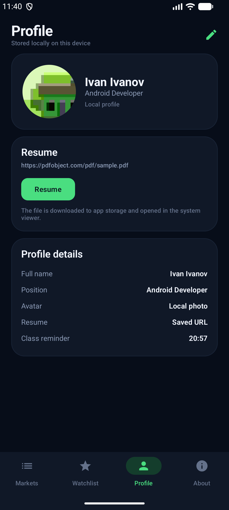
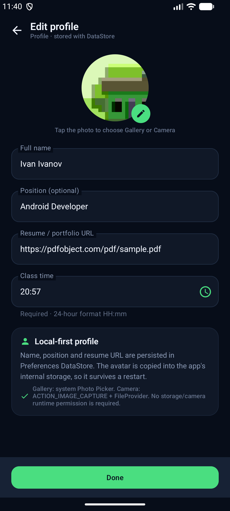

# CoinPulse — практика 8

Практика **«Многомодульность»**. Функции экранов **Profile** вынесены из монолита `app`
в отдельный Gradle-модуль `:feature:profile`, а общие ресурсы — в `:core:designsystem`.
Зависимости направлены только из `app` в модули: модули не зависят от `app`.

## Модули

| Модуль | Назначение |
| --- | --- |
| `:app` | Точка входа, `MainActivity`, Compose-навигация, Markets / Watchlist / Filters / About |
| `:feature:profile` | Экраны профиля и его редактирования, domain/data/notifications/res, unit-тесты |
| `:core:designsystem` | Тема, форматирование и общие composable-состояния (`EmptyState`, `ErrorState`, `SkeletonList`, …) |

```text
app ──────────► :feature:profile ──► :core:designsystem
 └────────────► :core:designsystem
```

- `app/build.gradle.kts` содержит `implementation(project(":core:designsystem"))`
  и `implementation(project(":feature:profile"))`.
- `feature/profile/build.gradle.kts` содержит только
  `implementation(project(":core:designsystem"))`.
- Ни в одном модуле нет `project(":app")` и импортов из `ru.urfu.coinpulse.*` верхнего уровня
  (`CoinPulseApplication`, `MainActivity`, app-`R`, app-`domain`/`data`).

## Как связаны app и feature

`ProfileComponent` — DI-граф самого модуля профиля (репозитории, use case'ы,
`AlarmReminderScheduler`). Наружу модуль отдаёт только:

```kotlin
interface ProfileDependenciesProvider {
    val profileComponent: ProfileComponent
}
```

`CoinPulseApplication` реализует этот интерфейс и создаёт компонент через
`ProfileFeature.create(this)`. ViewModel'и внутри `:feature:profile` получают зависимости
из `ProfileDependenciesProvider`, поэтому feature ничего не знает про `AppContainer` и `:app`.

`app` хранит только константы маршрутов и вызывает `ProfileRoute` / `EditProfileRoute`
из feature-модуля.

Уведомление о паре тоже не ссылается на `MainActivity` из `:app`: receiver запускает
приложение через `packageManager.getLaunchIntentForPackage(...)`.

## Структура feature-модуля

```text
feature/profile/src/main/java/ru/urfu/coinpulse/feature/profile/
  ProfileComponent.kt              # DI-граф + ProfileDependenciesProvider
  domain/model/UserProfile.kt
  domain/repository/               # ProfileRepository, AvatarRepository, ReminderScheduler
  domain/usecase/ProfileUseCases.kt
  domain/validation/ProfileValidator.kt
  domain/error/AppException.kt
  data/local/                      # DataStore, файлы аватара, FileProvider
  data/notifications/              # AlarmReminderScheduler, ClassReminderReceiver
  presentation/profile/            # ProfileRoute, EditProfileRoute, ViewModel'и
feature/profile/src/main/AndroidManifest.xml
feature/profile/src/main/res/      # иконки часов/уведомления, file_paths.xml
feature/profile/src/test/          # ProfileValidatorTest, UserProfileTest
```

Manifest модуля содержит `POST_NOTIFICATIONS`, `FileProvider` и
`ClassReminderReceiver` с полным именем класса; манифест приложения от них избавлен.
Итоговый manifest собирается слиянием: authority остаётся
`ru.urfu.coinpulse.fileprovider`, receiver —
`ru.urfu.coinpulse.feature.profile.data.notifications.ClassReminderReceiver`.

## Скриншоты

| Профиль (из `:feature:profile`) | Редактирование профиля |
| --- | --- |
|  |  |

## Проверка

```bash
./gradlew assembleDebug
./gradlew testDebugUnitTest
```

- `BUILD SUCCESSFUL`.
- **26 unit-тестов**, все проходят:
  - `:app` — 19 тестов (CoinMappers, CoinRepositoryImpl, CoinFilters, FilterBadgeCache);
  - `:feature:profile` — 7 тестов (ProfileValidator, UserProfile).
- Проверено на эмуляторе **Android 17 (API 37)**:
  - приложение запускается и открывает Profile-экран из модуля;
  - редактирование, валидация `HH:mm` и сохранение работают;
  - после «Done» профиль обновляется, а напоминание планируется через `AlarmManager`;
  - уведомление и переход в приложение продолжают работать после переноса кода в модуль.

## История практик

- Практика 3: `feature/practice-3-*`
- Практика 4: `feature/practice-4-*`
- Практика 5: `feature/practice-5-*`
- Практика 6: профиль, аватар (галерея/камера), резюме
- Практика 7: поле времени пары, `AlarmManager` + push-уведомление
- Практика 8: многомодульность (`:app` → `:feature:profile` → `:core:designsystem`)

## Ветка и PR

Ветка: `feature/practice-8-modularization`.

```bash
git push -u origin feature/practice-8-modularization
```

PR создаётся из `feature/practice-8-modularization` в `main`.
