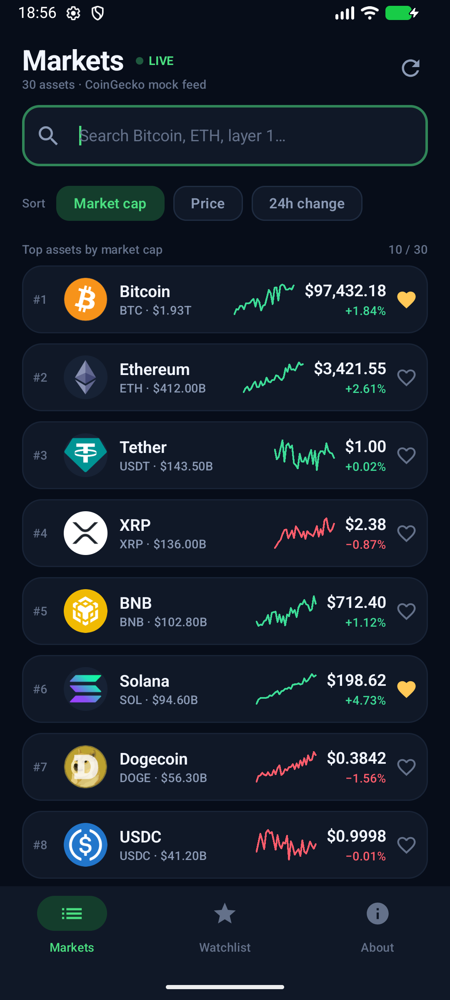
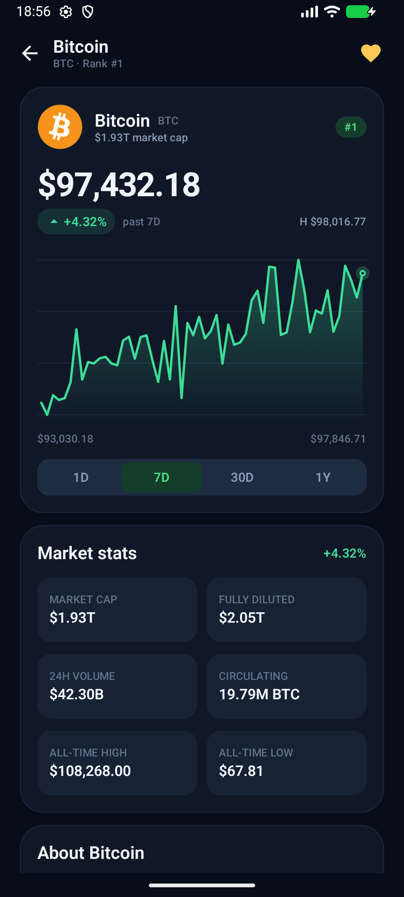
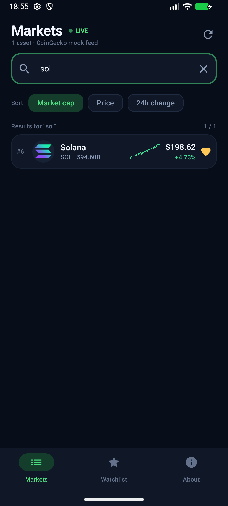
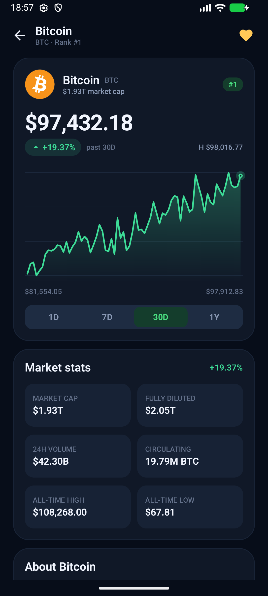
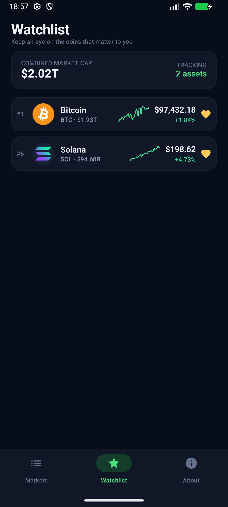
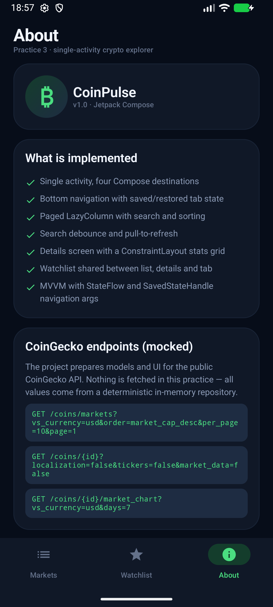

# CoinPulse — практика 3

Учебное Android-приложение по открытым данным **CoinGecko**: список криптовалют с поиском,
сортировкой и пагинацией, экран деталей и нижняя навигация. Данные в этой практике
**моковые** — сетевой слой появится в следующей практике, но модели и экраны уже
подготовлены под реальные ответы CoinGecko.

## Скриншоты

| Список монет | Экран деталей |
| --- | --- |
|  |  |
| **Поиск** | **Диапазон 30 дней** |
|  |  |
| **Watchlist** | **О приложении** |
|  |  |

ВИДЕО

https://github.com/user-attachments/assets/97b5b6cb-fb10-4d4e-b71c-c4c491aa2930


Дополнительно: [нижняя часть экрана деталей](docs/screenshots/details_bottom.png),
[пагинация до конца списка](docs/screenshots/pagination.png),
[сортировка по цене](docs/screenshots/sort_price.png),
[нижняя часть экрана About](docs/screenshots/about_bottom.png).

## Что реализовано

- **Single Activity** — `MainActivity` + Jetpack Compose, без XML-экранов.
- **Bottom navigation** — Markets / Watchlist / About, состояние вкладок сохраняется и
  восстанавливается (`saveState` / `restoreState`).
- **Список** — `LazyColumn` с ключами, карточками, спарклайнами и `CoinRow`.
- **Пагинация** — по 10 монет, `loadMore()` срабатывает при приближении к концу списка,
  есть индикатор загрузки и состояние «конец ленты». Всего в мок-фиде 30 монет.
- **Поиск** — по названию, тикеру и id с debounce 300 мс.
- **Сортировка** — по капитализации, цене и изменению за 24 часа.
- **Pull-to-refresh** — `PullToRefreshBox` из Material 3.
- **Экран деталей** — переход по `coin/{coinId}`, график цены с диапазонами 1D/7D/30D/1Y,
  сложная сетка характеристик на **ConstraintLayout**, описание с «Read more», ссылки,
  категории и метаданные.
- **Watchlist** — общий набор избранного для списка, деталей и отдельной вкладки;
  изменение мгновенно отражается на всех экранах.
- **MVVM** — ViewModel + `StateFlow` + `collectAsStateWithLifecycle`, репозиторий за
  интерфейсом, ручная фабрика ViewModel без DI-фреймворков.
- **Тёмная тема**, edge-to-edge, собственный splash screen на Android 12+.
- **8 unit-тестов** на пагинацию, поиск, сортировку, избранное и графики.

## Стек

| Слой | Технологии |
| --- | --- |
| UI | Kotlin, Jetpack Compose, Material 3 |
| Навигация | Navigation Compose |
| Состояние | ViewModel, StateFlow, Coroutines, SavedStateHandle |
| Сложная разметка | ConstraintLayout Compose |
| Изображения | Coil 2 |
| Сборка | Gradle 8.11.1, AGP 8.7.0, Kotlin 2.0.21 |
| Тесты | JUnit 4, kotlinx-coroutines-test |

## Архитектура

```
app/src/main/java/ru/urfu/coinpulse/
├── MainActivity.kt                 # единственная Activity
├── CoinPulseApplication.kt         # ручной service locator: один MockCoinRepository
├── data/
│   ├── Coin.kt                     # Coin, CoinDetails, CoinPage, CoinSort, ChartRange
│   ├── CoinRepository.kt           # контракт источника данных
│   ├── MockCoinRepository.kt       # пагинация, поиск, сортировка, избранное, задержки сети
│   └── MockCoinData.kt             # 30 монет + генерация деталей и графиков
└── ui/
    ├── navigation/                 # Routes, CoinPulseApp, нижняя навигация
    ├── market/                     # MarketScreen + MarketViewModel
    ├── details/                    # CoinDetailsScreen + CoinDetailsViewModel
    ├── watchlist/                  # WatchlistScreen + WatchlistViewModel
    ├── about/                      # AboutScreen
    ├── components/                 # CoinRow, CoinLogo, Sparkline, PriceChart, состояния
    ├── format/                     # форматирование цен, процентов и капитализации
    └── theme/                      # цвета, типографика, MaterialTheme
```

Поток данных:

```
Compose screen ──(intent)──> ViewModel ──(suspend)──> CoinRepository
      ▲                          │
      └──── StateFlow<UiState> ──┘
```

- UI не знает, откуда приходят данные: `MockCoinRepository` легко заменяется на
  Retrofit/OkHttp-реализацию.
- `MockCoinRepository` имитирует сетевые задержки (650 мс для списка, 450 мс для деталей),
  поэтому видны скелетоны и индикатор пагинации.
- `MarketUiState` и `CoinDetailsUiState` — иммутабельные data-классы; все изменения
  проходят через `MutableStateFlow.update`.
- `coinId` передаётся через маршрут `coin/{coinId}` и читается в `CoinDetailsViewModel`
  из `SavedStateHandle`.

## Соответствие данным CoinGecko

| Экран | Реальный endpoint | Поля |
| --- | --- | --- |
| Список | `GET /coins/markets?vs_currency=usd&order=market_cap_desc&per_page=10&page=1` | id, symbol, name, image, current_price, market_cap, market_cap_rank, total_volume, high_24h, low_24h, price_change_percentage_24h/7d, circulating_supply, max_supply, ath, atl, sparkline |
| Детали | `GET /coins/{id}?localization=false&tickers=false&market_data=false` | description, links, categories, genesis_date, hashing_algorithm, market_data, last_updated |
| График | `GET /coins/{id}/market_chart?vs_currency=usd&days=1\|7\|30\|365` | prices (мок-серия, детерминированная по id и диапазону) |

Ссылка на выбранную предметную область:
[CoinGecko API](https://docs.coingecko.com/reference/introduction).

## Навигация

```
market ──────────────┐
watchlist ───────────┼──> coin/{coinId}
about                │
                     └── bottom bar виден только на корневых вкладках
```

- Нижняя панель скрыта на экране деталей.
- Переключение вкладок использует `popUpTo(startDestination) { saveState = true }`,
  `launchSingleTop` и `restoreState`.
- Назад с экрана деталей возвращает к списку и сохраняет позицию скролла.

## Сборка и запуск

Требования: JDK 17, Android SDK 35, эмулятор или устройство с API 24+.

```bash
./gradlew assembleDebug          # APK: app/build/outputs/apk/debug/app-debug.apk
./gradlew testDebugUnitTest      # unit-тесты
```

Или открыть папку проекта в Android Studio и запустить конфигурацию `app`.

## Тесты

`app/src/test/java/ru/urfu/coinpulse/data/MockCoinRepositoryTest.kt`:

- размер первой страницы и наличие следующих;
- последняя страница и страница за пределами списка;
- поиск по названию и тикеру;
- сортировка по цене и изменению за 24 часа;
- общее избранное и его переключение;
- поля деталей и длина/конец графиков.

## Ветка и merge request

Работа ведётся в ветке `feature/practice-3-coinpulse`:

```bash
git checkout -b feature/practice-3-coinpulse
git add .
git commit -m "feat: CoinPulse market, details and bottom navigation"
git push -u origin feature/practice-3-coinpulse
```

После push открыть merge request в GitHub/GitLab из этой ветки в `main` и прикрепить
ссылку на MR в таблицу практики.

## Демо

Запись экрана: `docs/demo.mp4` (создаётся локально при сдаче и не коммитится в git,
чтобы не увеличивать репозиторий).
