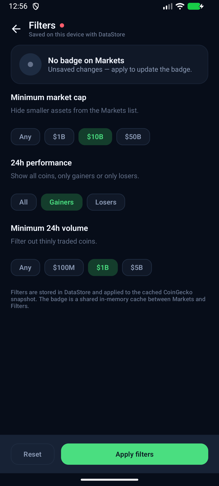
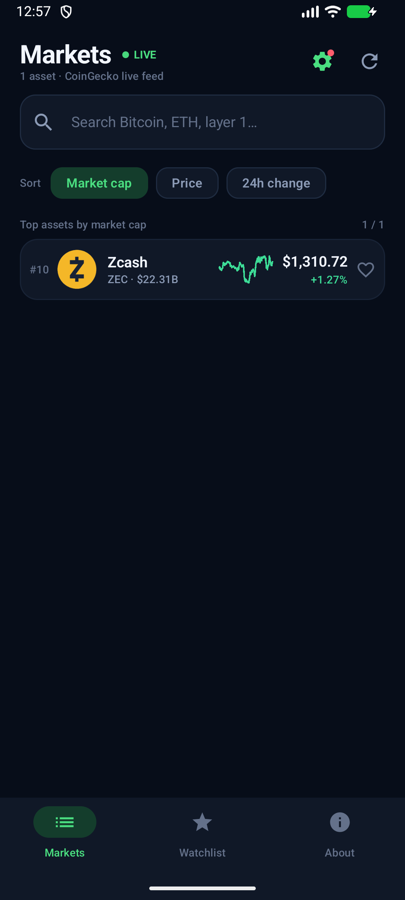
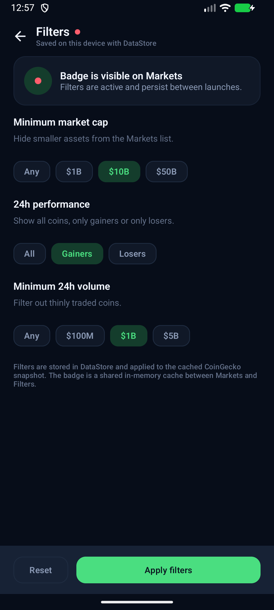
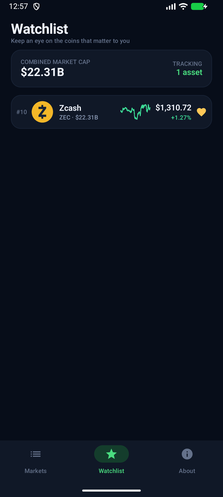
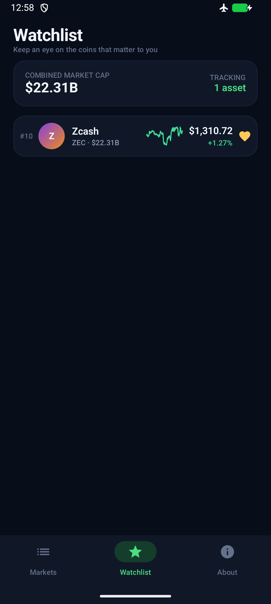
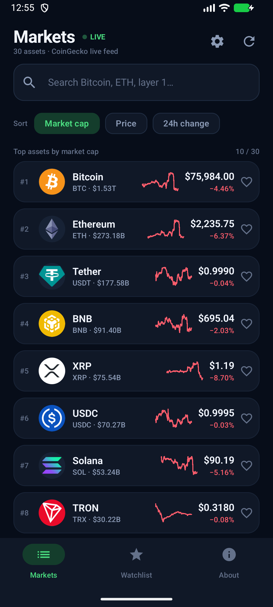

# CoinPulse — практика 5

Android-приложение по данным CoinGecko: живой список криптовалют, детали, графики,
watchlist и нижняя навигация. В этой практике добавлены **локальное хранение и фильтрация**:

1. **Фильтры** — отдельный экран с тремя настройками, сохранение в **DataStore**.
2. **Избранное** — отдельный экран Watchlist на **Room**, доступен без интернета.
3. **Бейдж** — общий in-memory кэш для экранов Markets и Filters, создаётся через **DI**.

## Скриншоты

| Фильтры: три настройки | Список с активным бейджем |
| --- | --- |
|  |  |
| **Настройки после перезапуска** | **Избранное в Room** |
|  |  |
| **Избранное без интернета** | **Список по умолчанию** |
|  |  |

Дополнительно: [фильтры в исходном состоянии](docs/screenshots/p5_filters.png).

## Демо

- Практика 3: https://github.com/user-attachments/assets/97b5b6cb-fb10-4d4e-b71c-c4c491aa2930
- Практика 4: `docs/demo_practice4.mp4` (локальная запись, прикладывается отдельно)
- Практика 5: `docs/demo_practice5.mp4` (локальная запись, прикладывается отдельно)

В записи практики 5: ввод фильтров → Apply → список перезагружается с бейджем →
приложение выгружается из памяти → настройки и бейдж на месте → добавление в избранное →
отключение интернета → избранное открывается из Room.

## Задача 1. Поиск и фильтрация

Отдельный экран `Filters` открывается с иконки в шапке Markets.

Три настройки:

| Настройка | Значения |
| --- | --- |
| Minimum market cap | Any / $1B / $10B / $50B |
| 24h performance | All / Gainers / Losers |
| Minimum 24h volume | Any / $100M / $1B / $5B |

- Значения сохраняются в **Preferences DataStore** (`coin_filters`) по кнопке **Apply filters**.
- `MarketViewModel` подписан на Flow фильтров из DataStore и перезагружает список при их изменении.
- Фильтрация применяется до поиска, сортировки и пагинации по закэшированному снимку топ-30
  CoinGecko (снимок загружается по сети).
- После перезапуска приложения настройки восстанавливаются, список открывается уже
  отфильтрованным.

Ключи DataStore:

```text
min_market_cap : Long
performance    : String (ALL / GAINERS / LOSERS)
min_volume_24h : Long
```

## Задача 2. Избранное на Room

Экран **Watchlist** — это отдельный экран избранного.

- `FavoriteCoinEntity` — Room-сущность с полным снимком монеты (цена, капитализация,
  изменение, спарклайн и т.д.).
- `FavoriteCoinDao` — `Flow<List<FavoriteCoinEntity>>`, `insert`, `delete`, `exists`.
- `CoinPulseDatabase` — база `coinpulse.db`, TypeConverter для `List<Double>` (sparkline).
- Добавление/удаление — сердечко в списке, на экране деталей или в Watchlist.
- Так как хранится полный снимок, **избранное доступно без интернета**: проверено
  включением авиарежима, полной остановкой процесса и повторным запуском.
- При загрузке рынка/деталей снимки избранных монет обновляются свежими ценами.

## Задача 3. Бейдж

- `FilterBadgeCache` — общий класс с `StateFlow<Boolean>`.
- Создаётся один раз в `AppContainer` и инжектится в `MarketViewModel` и `FilterViewModel`.
- В шапке Markets у иконки фильтров появляется красная точка, если активна хотя бы
  одна настройка.
- На экране Filters показывается состояние бейджа и подсказка про несохранённые изменения.
- Сам факт показа бейджа отдельно **не сохраняется**: при запуске он восстанавливается
  из DataStore-фильтров в общий in-memory кэш.

## Архитектура

```
app/src/main/java/ru/urfu/coinpulse/
├── di/AppContainer.kt                  # Room, DataStore, use cases, FilterBadgeCache
├── domain/
│   ├── model/                          # Coin, CoinFilters, PerformanceFilter, ...
│   ├── repository/                     # CoinRepository, FilterRepository
│   ├── error/AppException.kt
│   └── usecase/                        # GetCoins, filters, favorites, details, chart
├── data/
│   ├── local/
│   │   ├── CoinPulseDatabase.kt        # Room
│   │   ├── FavoriteCoinEntity.kt
│   │   ├── FavoriteCoinDao.kt
│   │   ├── FavoriteConverters.kt
│   │   └── FilterRepositoryImpl.kt     # DataStore
│   ├── network/NetworkModule.kt        # Retrofit / OkHttp / Chucker
│   ├── remote/                         # CoinGeckoApi, DTO, mappers
│   └── repository/CoinRepositoryImpl.kt
└── presentation/
    ├── market/                         # список + фильтры + бейдж
    ├── filters/                        # экран настроек + FilterBadgeCache
    ├── details/
    ├── watchlist/                      # Room-backed избранное
    ├── about/
    ├── components/
    ├── navigation/
    └── theme/
```

Направление зависимостей:

```
presentation ──> domain <── data
```

`domain` не знает про Android, Room, DataStore и Retrofit. `data` реализует контракты
`CoinRepository` и `FilterRepository`. `presentation` работает с use cases; ViewModels
не обращаются к DAO/DataStore напрямую.

## Сетевой слой

Сохранён из практики 4:

- Retrofit + OkHttp + Gson, запросы на `Dispatchers.IO`;
- `GET /coins/markets` для списка;
- `GET /coins/{id}` для деталей;
- `GET /coins/{id}/market_chart` для графика;
- loading / error / retry состояния;
- Chucker в debug-сборке (About → Network inspector).

## Тесты

```bash
./gradlew testDebugUnitTest
```

19 unit-тестов:

- mappers, chart points;
- параметры запроса, кэш, force refresh;
- фильтрация по капитализации, объёму и 24h performance;
- ошибки `IOException` и HTTP 429;
- кэш деталей и sparkline для 1D/7D;
- избранное через DAO и сохранение снимков;
- `CoinFilters` и `FilterBadgeCache`.

## Сборка и проверка

```bash
./gradlew assembleDebug
./gradlew testDebugUnitTest
```

APK: `app/build/outputs/apk/debug/app-debug.apk`.

Ручной сценарий:

1. Markets → иконка фильтров → выбрать $10B / Gainers / $1B → **Apply filters**.
2. Список перезагружается, у иконки фильтров появляется бейдж.
3. Полностью закрыть приложение (force-stop) и открыть снова — фильтры и бейдж на месте.
4. Добавить монету в избранное сердечком.
5. Открыть Watchlist — монета в Room-избранном.
6. Включить авиарежим, остановить приложение, открыть снова → Watchlist работает без сети.

## Ветка и PR

Ветка практики: `feature/practice-5-storage`.

```bash
git push -u origin feature/practice-5-storage
```

PR создаётся из `feature/practice-5-storage` в `main`; ссылка добавляется в таблицу практики.
