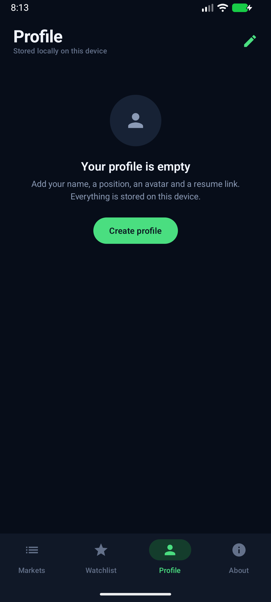
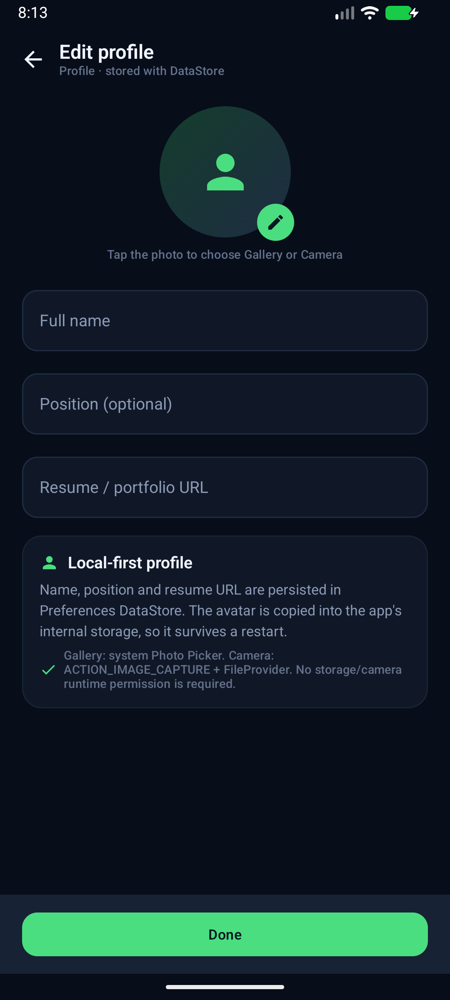
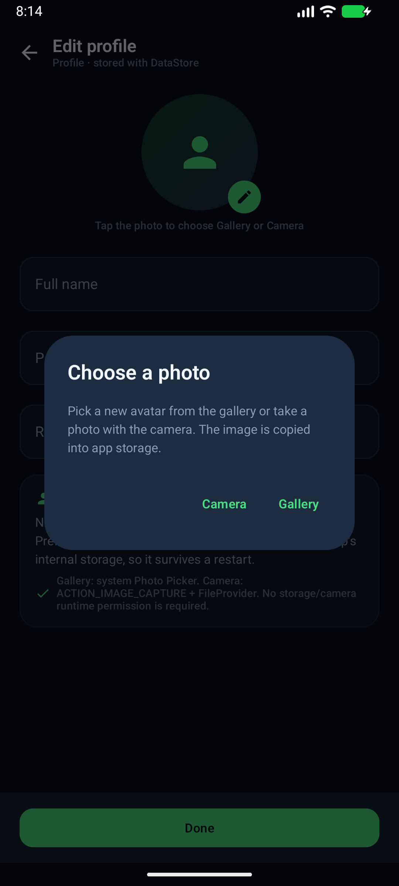
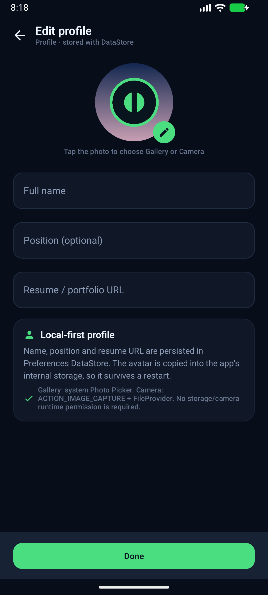
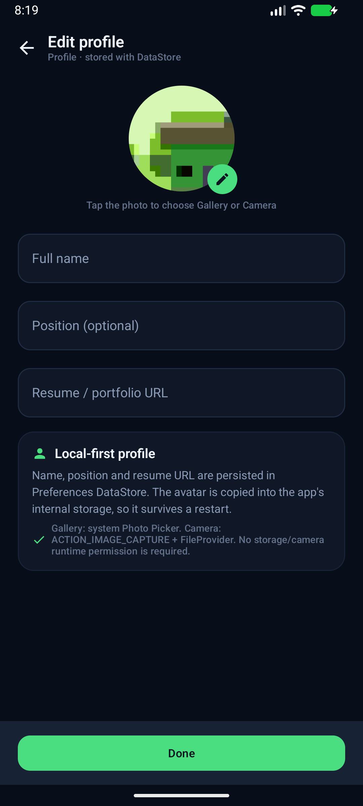
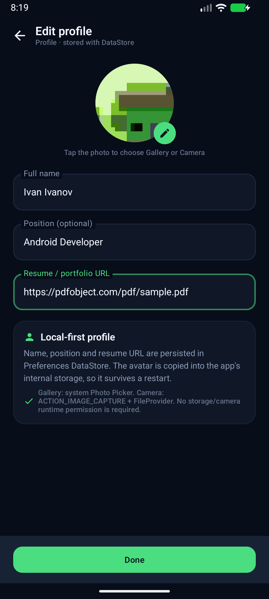
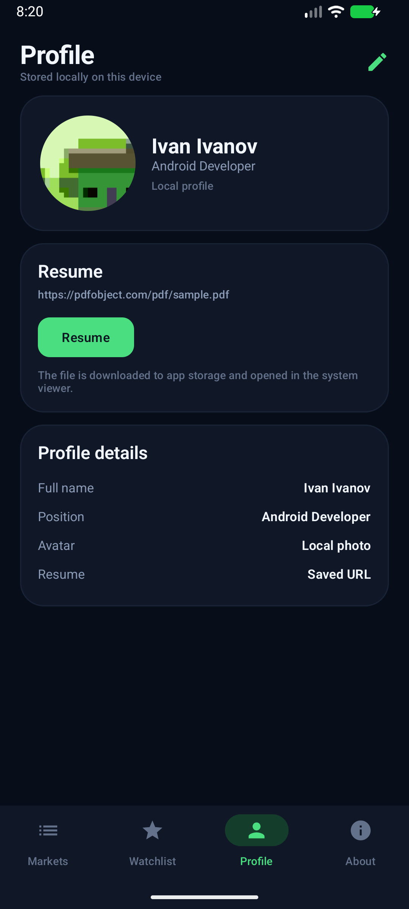
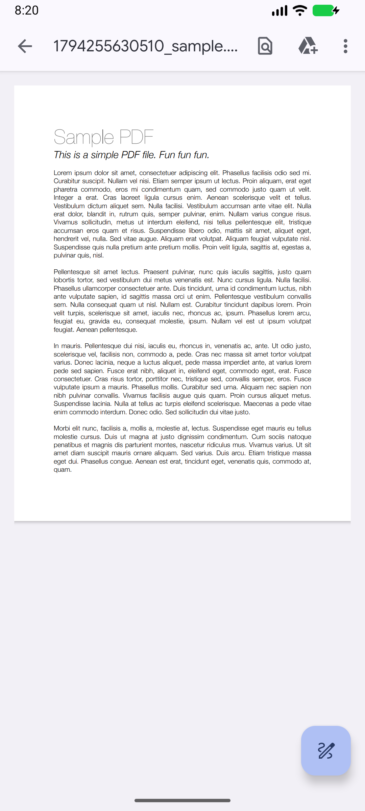

# CoinPulse — практика 6

Android-приложение по данным CoinGecko с профилем пользователя. В этой практике добавлена
вкладка **Profile** и экран **Edit profile**:

- ФИО, должность, аватар и ссылка на резюме;
- аватар из галереи или с камеры;
- сохранение профиля на устройстве между запусками;
- скачивание резюме по URL и открытие файла в системном просмотрщике.

## Скриншоты

| Пустой профиль | Редактирование профиля |
| --- | --- |
|  |  |
| **Выбор источника аватара** | **Аватар из галереи** |
|  |  |
| **Аватар с камеры** | **Заполненное редактирование** |
|  |  |
| **Готовый профиль** | **Резюме в PDF-просмотрщике** |
|  |  |

После перезапуска приложения профиль восстанавливается:
[скриншот](docs/screenshots/p6_profile_persisted.png).

## Демо

- Практика 3: https://github.com/user-attachments/assets/97b5b6cb-fb10-4d4e-b71c-c4c491aa2930
- Практика 4: `docs/demo_practice4.mp4`
- Практика 5: `docs/demo_practice5.mp4`
- Практика 6: **`docs/demo_practice6.mp4`**

В записи практики 6: пустой профиль → редактирование → выбор фото → галерея → камера →
ввод имени и ссылки → Done → заполненный профиль → Resume → PDF открывается в просмотрщике.
Видеофайлы не коммитятся в git и прикладываются к сдаче отдельно.

## Экраны

### Profile

- Аватар, ФИО, должность.
- Карточка **Resume** с URL и кнопкой скачивания/открытия.
- Карточка **Profile details**.
- Кнопка-карандаш в шапке и действие **Create profile** для пустого состояния.

### Edit profile

- Аватар с выбором источника: **Gallery** или **Camera**.
- Текстовые поля:
  - Full name;
  - Position (optional);
  - Resume / portfolio URL.
- Кнопка **Done**.
- Ошибки валидации: пустое имя, ссылка не с `http://`/`https://`.
- Если пользователь отменяет камеру или выбор фото, изменения не применяются;
  временный файл камеры удаляется.

## Хранение

Профиль — это **одна запись**, поэтому выбрано **Preferences DataStore**, а не Room:

```text
user_profile:
  full_name   : String
  position    : String
  resume_url  : String
  avatar_uri  : String
```

- `avatar_uri` указывает на файл внутри приложения (`filesDir/avatars/...`) через
  `FileProvider`.
- Изображение из галереи копируется в внутреннее хранилище, поэтому не зависит от
  временного разрешения на content URI.
- Снимок камеры пишется сразу в файл приложения через `FileProvider`.
- Скачанное резюме сохраняется в `cacheDir/resume/...` и открывается через `FileProvider`
  с `ACTION_VIEW` и `FLAG_GRANT_READ_URI_PERMISSION`.
- В манифесте зарегистрирован `FileProvider` с путями `avatars/` и `resume/`.

## Аватар и разрешения

Использован современный сценарий **без явных runtime-разрешений** (это разрешено
обновлением задания от октября 2026):

- **Галерея** — `ActivityResultContracts.PickVisualMedia` (system Photo Picker).
  Не требуется `READ_MEDIA_IMAGES` / `READ_EXTERNAL_STORAGE`.
- **Камера** — `ActivityResultContracts.TakePicture` + `ACTION_IMAGE_CAPTURE` через
  `FileProvider`. Приложение не объявляет `CAMERA`, поэтому отдельный runtime-запрос
  камеры не нужен.

Следствие: стандартного диалога «разрешить доступ к файлам» в сценарии нет, и ветки
«пользователь запретил доступ» тоже нет. Если пользователь закрывает Photo Picker или
камеру, экран редактирования просто остаётся открытым, а временный файл удаляется.

Проверено на эмуляторе **Android 17 (API 37)**. `minSdk = 24`; контракты Activity Result
поддерживают fallback на системный выбор документов на более старых версиях. Других
системных образов в окружении не было, поэтому отдельно на API 24–36 приложение не
запускалось.

## Скачивание резюме

- URL проверяется на `http://` / `https://`.
- OkHttp скачивает файл на `Dispatchers.IO`, имя и MIME определяются из URL/ответа.
- При успехе UI получает `DownloadedDocument(filePath, mimeType, displayName)`.
- `ProfileScreen` создаёт content-URI через `FileProvider` и запускает системный
  `ACTION_VIEW`.
- Проверено с `https://pdfobject.com/pdf/sample.pdf`: файл скачался и открылся в
  Google Drive PDF Viewer.

## Архитектура

```
app/src/main/java/ru/urfu/coinpulse/
├── di/AppContainer.kt               # DataStore профиля, AvatarRepository, use cases
├── domain/
│   ├── model/UserProfile.kt         # UserProfile, DownloadedDocument, CameraTarget
│   ├── repository/ProfileRepository.kt
│   ├── repository/AvatarRepository.kt
│   ├── validation/ProfileValidator.kt
│   └── usecase/ProfileUseCases.kt
├── data/
│   ├── local/ProfileRepositoryImpl.kt   # DataStore + OkHttp download
│   ├── local/AvatarRepositoryImpl.kt    # FileProvider + внутренние файлы
│   └── ...
└── presentation/
    ├── profile/ProfileScreen.kt
    ├── profile/EditProfileScreen.kt
    ├── profile/ProfileViewModel.kt
    ├── profile/EditProfileViewModel.kt
    └── ...
```

- ViewModels управляют состоянием и вызывают use cases.
- Activity Result contracts находятся в UI-слое, как и положено для Android API.
- `domain` не зависит от Android/FileProvider/DataStore.
- Профиль хранится в `ProfileRepositoryImpl`; аватар и файлы — в data-слое.

## Тесты

```bash
./gradlew testDebugUnitTest
```

24 unit-теста: существующие тесты сети, фильтров, Room-избранного и новые тесты
`ProfileValidator`/`UserProfile`. Все проходят.

## Сборка

```bash
./gradlew assembleDebug
```

## Сценарий проверки

1. Открыть вкладку **Profile** — профиль пуст.
2. **Create profile / Edit**.
3. Нажать на аватар → **Gallery** → выбрать фото → оно появляется в редактировании.
4. Нажать на аватар → **Camera** → снять фото → подтвердить.
5. Ввести ФИО и ссылку `https://pdfobject.com/pdf/sample.pdf`.
6. **Done** → профиль заполнен.
7. **Resume** → PDF скачивается и открывается в системном просмотрщике.
8. Перезапустить приложение → профиль, аватар и ссылка на месте.

## Ветка и PR

Ветка: `feature/practice-6-profile`.

```bash
git push -u origin feature/practice-6-profile
```

PR создаётся из `feature/practice-6-profile` в `main`; ссылка добавляется в таблицу практики.
